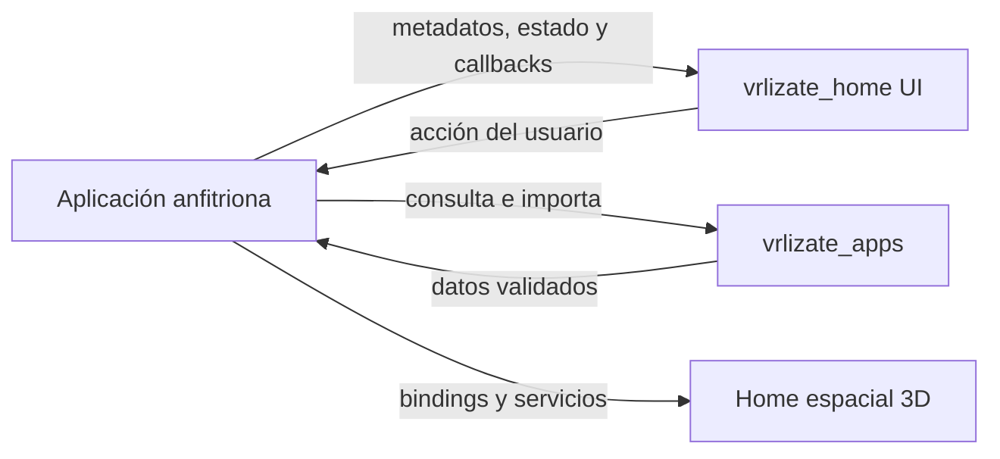

# vrlizate_home

Pantallas de entrada, catálogo 2D, biblioteca de paquetes y lobby espacial 3D para **VRlizate**.

> Versión actual: **0.1.0**. Consulta [CHANGELOG.md](CHANGELOG.md) para el historial de cambios.

## Arquitectura y responsabilidad

`vrlizate_home` presenta datos y acciones inyectadas por el anfitrión; no escanea discos, no descarga paquetes `.vrlz` ni ejecuta runtimes por su cuenta. El paquete hermano [`vrlizate_apps`](../vrlizate_apps/README.md) administra formatos, descubrimiento y transporte.



## Superficies públicas

- **`vrlizate_home.dart`:** pantalla de entrada (`VrHomeLanding`), catálogo 2D con búsqueda/filtros (`VrHomeCatalog`), biblioteca de paquetes (`VrHomePackageLibrary`) y temas (`Aurora`, `Día`, `Medianoche`) sin inicializar GPU.
- **`vrlizate_home_catalog.dart`:** modelos de inventario y categorías independientes de GPU.
- **`vrlizate_home_spatial.dart`:** lobby espacial 3D (`VirtualHomeView`), plaza cubierta con ocho locales del ecosistema, biblioteca 3D, locomoción con colisión y giro progresivo en borde de stick, puntero láser/mirada y escenario de avatar (`HomeShowcase`).

## Uso básico

```dart
VrHomeLanding(
  theme: VrHomeThemeData.aurora,
  onThemeChanged: selectTheme,
  onExplore: null,
  onViewer: openSpatialHome,
  onController: openController,
)
```

Para la biblioteca de paquetes:

```dart
VrHomePackageLibrary(
  items: packageCards,
  location: sourceLabel,
  issues: notices,
  busy: operationInProgress,
  error: operationError,
  onLaunch: launchKnownPackage,
  onRefresh: refreshSource,
  onImport: showImportDialog,
  onInstallExamples: installExamplesExplicitly,
  onUseLocal: returnToLocalFolder,
  onCopyLocation: copySourceLabel,
)
```

## Reproductor de referencia (`example/`)

El ejecutable `example/` combina `vrlizate_home`, `vrlizate_apps` y `VrlzSceneViewer` usando únicamente `MaterialApp` y `Navigator` estándar de Flutter:

```sh
flutter pub get
FLUTTER_DART_DATA_ASSETS=false flutter test
cd example
flutter pub get
FLUTTER_DART_DATA_ASSETS=false flutter run --profile -d macos
```

## Licencia

Apache License 2.0 — consulta [LICENSE](LICENSE).
